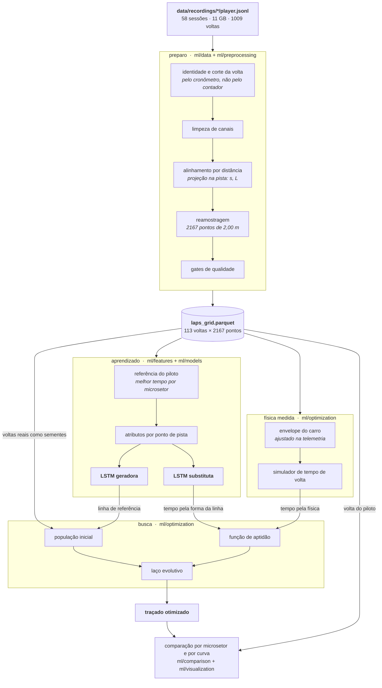
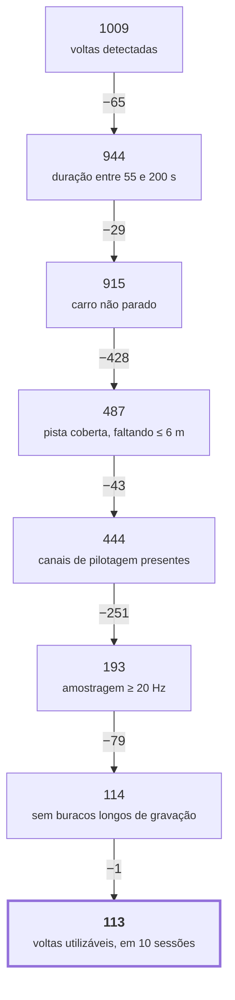
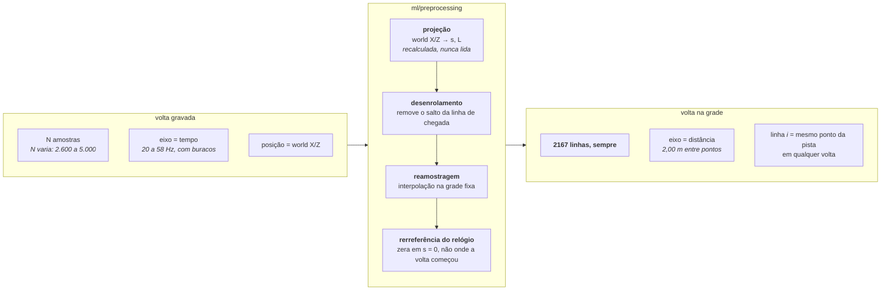
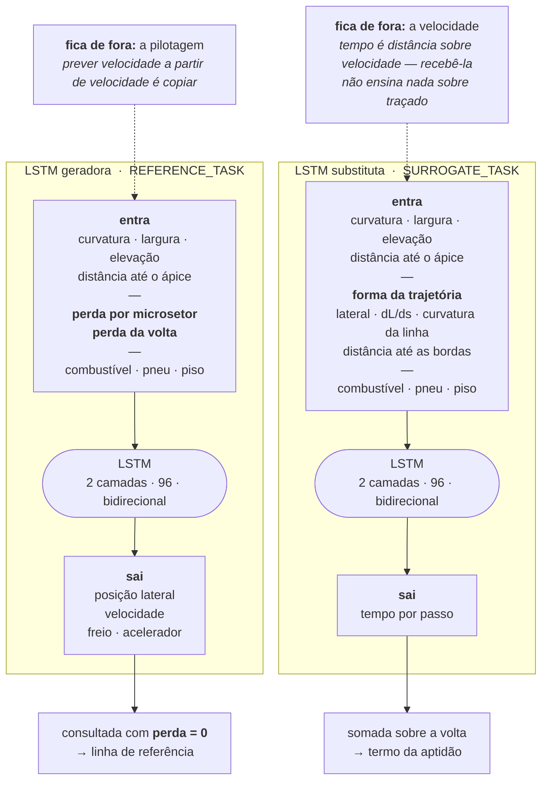
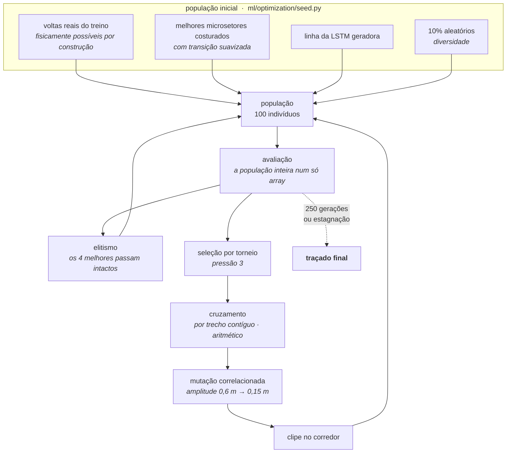
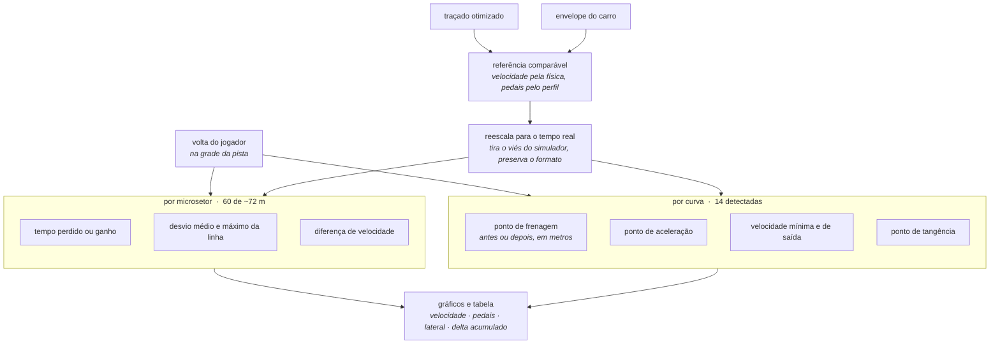
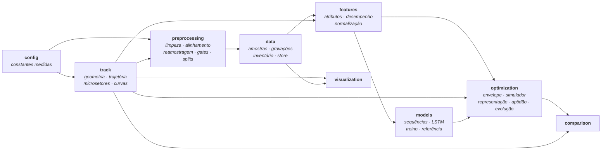

# Arquitetura do subsistema de aprendizado de traçado

Diagramas do sistema como ele ficou implementado em [`backend/ml/`](../backend/ml/),
não do desenho inicial — vários pontos mudaram durante a construção, e onde
mudaram o diagrama traz o motivo.

Todos os números são medidos no dataset real: 58 sessões de Interlagos,
11 GB, 1009 voltas brutas detectadas.

---

## Figura 1 — Arquitetura geral

O caminho completo, da gravação bruta ao feedback por curva.

**A leitura que importa:** as duas redes entram em lugares diferentes. A geradora
alimenta a *semente* da busca; a substituta alimenta o *julgamento*. Nenhuma das
duas decide sozinha — a física entra na aptidão ao lado da rede, porque uma rede
treinada nas voltas do piloto só sabe premiar o que já viu e nunca apontaria
nada melhor que a melhor volta dele.

---

## Figura 2 — Funil de qualidade

Quantas voltas sobrevivem a cada gate, aplicados em sequência.

**Por que cada corte existe:** cada gate em
[`preprocessing/quality.py`](../backend/ml/preprocessing/quality.py) tem, no
comentário, a volta concreta do dataset que passaria sem ele. Os dois maiores
cortes são os mais instrutivos.

- **Cobertura (−428).** Uma volta interrompida no meio da gravação tem tempo
  plausível e cobre meia pista. E mesmo perto do fim importa: 16 m sem gravação
  antes da linha viravam um microsetor de 0,719 s — 360 km/h numa reta onde o
  carro faz 271 — que entrava na referência do piloto como recorde.
- **Amostragem (−251).** As duas voltas "mais rápidas" do dataset, 82,698 s e
  83,469 s, foram gravadas a 7,6 Hz. São gravações truncadas reportando tempo
  menor, não recordes.

---

## Figura 3 — De amostra no tempo a ponto na pista

A transformação central do pré-processamento: o que entra é irregular no tempo,
o que sai é fixo no espaço.

**Por que isso é o que torna tudo possível:** duas voltas nunca têm o mesmo
número de amostras nem os mesmos instantes, então compará-las quadro a quadro
compara pontos diferentes da pista. Depois desta etapa, somar, subtrair e cruzar
voltas passa a ser aritmética de vetores do mesmo tamanho — e é isso que o
cruzamento do algoritmo evolutivo exige para significar alguma coisa.

Duas armadilhas que o diagrama resolve, e que custaram uma versão cada:

- **`distanceAlongTrack` gravado não serve.** Seis sessões o gravaram como
  `null`, e as que gravaram usaram versões diferentes da geometria. A projeção é
  refeita aqui e bate com o runtime dentro de 0,15 m no p95.
- **O relógio dava a volta no meio do vetor.** A volta começa em `s ≈ 3 m` e a
  grade em `s = 0`, então os primeiros pontos da grade são o *fim* da volta. Sem
  rerreferenciar, o tempo acumulado não é monotônico e o primeiro microsetor sai
  com 0,019 s.

---

## Figura 4 — As duas redes

O desenho central do sistema. O que **não** entra em cada rede é tão decisivo
quanto o que entra.

**O que o condicionamento faz:** a geradora recebe *quanto aquela volta perdeu*
para a melhor do piloto naquele microsetor. Sem esse atributo, o único jeito de
a rede acertar todas as voltas de uma vez é responder a média delas — que é
exatamente o que o enunciado proíbe. Com ele, pede-se a pilotagem
correspondente à perda zero: uma volta em que o piloto esteve no próprio
recorde em todos os trechos ao mesmo tempo, e que ele nunca deu.

**Que funcionou, medido:** pedindo perda 0,0 s a rede responde 199 km/h de
mediana; pedindo 0,5 s, responde 134 km/h, e a linha se desloca 3,4 m em média.
Se ela tivesse aprendido a média, as duas respostas seriam iguais.

**O retreino de novembro (pedido 44).** A rede retreinada responde 207 km/h com
perda 0 e 148 km/h com 0,5 s, e a linha se desloca 3,1 m na mediana. As duas
respostas ficam fora do que as voltas reais fazem: a mediana de velocidade de
uma volta real vai de 155 a 202 km/h. E 0,5 s em cada um dos 60 microssetores
somariam 30 s, com a perda da volta pedida em 0,5 s. O condicionamento faz
efeito, mas essa consulta é uma extrapolação, não uma volta possível.

---

## Figura 5 — Função de aptidão

Como o custo de um indivíduo é montado. Tudo em segundos, antes de somar.

```mermaid
flowchart TB
  IND["indivíduo<br/><i>361 valores de deslocamento lateral</i>"]
  DEC["decodificação<br/><i>spline periódica → 2167 pontos</i><br/><i>clipe no corredor da pista</i>"]
  IND --> DEC

  DEC --> T1["<b>simulador quase-estacionário</b><br/>limite de curva → frenagem → tração<br/>com elipse de atrito"]
  DEC --> T2["<b>LSTM substituta</b><br/>tempo que este piloto faz<br/>numa linha desta forma"]
  DEC --> P1["fora dos limites<br/><i>rede de segurança: 0 por construção</i>"]
  DEC --> P2["serpenteio acima do p95 real"]
  DEC --> P3["variação de curvatura acima do p95 real"]

  T1 --> MIX["<b>tempo combinado</b><br/>&#40;1 − α&#41; · física &nbsp;+&nbsp; α · rede<br/><i>α = 0,25</i>"]
  T2 --> MIX

  MIX --> COST["<b>custo</b> = tempo combinado + penalizações"]
  P1 --> COST
  P2 --> COST
  P3 --> COST
```

**Por que dois tempos.** A simulação física não sabe nada deste piloto: diz o
que o carro aguenta. A rede não sabe nada de trajetórias que ninguém dirigiu:
diz o que este piloto costuma extrair de uma linha com esta forma. Só a física
produz um traçado que ninguém consegue seguir; só a rede produz um traçado que
nunca supera a melhor volta já gravada.

**Por que as penalizações de forma são calibradas nas voltas reais.** "Volante
demais" não tem valor absoluto — depende da pista e do carro. Os limiares saem
do p95 das voltas gravadas: o que o piloto faz de verdade não é penalizado, o
que passa disso é.

---

## Figura 6 — Laço evolutivo

**Por que os operadores são estes.** O genoma é uma curva amostrada: genes
vizinhos descrevem metros vizinhos de pista e são fortemente correlacionados.
Isso muda o que funciona — cruzamento uniforme sorteia cada ponto de um pai
diferente e produz uma linha que oscila entre as duas, pior que ambas; herdar
trechos inteiros herda *decisões*. E a mutação é suavizada ao longo da pista
antes de ser somada, porque ruído branco em pontos de controle vizinhos é
exatamente a oscilação de alta frequência que o simulador pune: a mutação sairia
sempre pior e a busca pararia de explorar.

---

## Figura 7 — Comparação com o piloto

**Duas unidades porque as perguntas são de naturezas diferentes.** O microsetor
responde *onde* se perdeu tempo — corte regular, o mesmo que o painel de análise
assistida do aplicativo já usa. A curva responde *por quê* — ponto de frenagem,
tangência e velocidade de saída só existem em relação a uma curva.

Tudo é medido na grade da pista, então "freou 12 m depois" é uma diferença de
distância de verdade, e não uma diferença de índice de amostra entre duas voltas
que têm números de amostras diferentes.

---

## Figura 8 — Mapa dos módulos

Quem depende de quem. As setas apontam para a dependência.

O pacote não é importado pelo runtime do aplicativo em ponto nenhum: ele lê o
que o runtime grava, e escreve em `data/ml/`. É o que permite manter o PyTorch
fora do executável empacotado.

---

## Onde cada diagrama vive no código

| figura | módulos |
|---|---|
| 1 — arquitetura geral | todo o pacote |
| 2 — funil de qualidade | [`preprocessing/quality.py`](../backend/ml/preprocessing/quality.py) · [`data/inventory.py`](../backend/ml/data/inventory.py) |
| 3 — amostra → ponto de pista | [`preprocessing/alignment.py`](../backend/ml/preprocessing/alignment.py) · [`preprocessing/resampling.py`](../backend/ml/preprocessing/resampling.py) |
| 4 — as duas redes | [`models/sequences.py`](../backend/ml/models/sequences.py) · [`models/lstm.py`](../backend/ml/models/lstm.py) |
| 5 — aptidão | [`optimization/fitness.py`](../backend/ml/optimization/fitness.py) · [`optimization/lap_time_model.py`](../backend/ml/optimization/lap_time_model.py) |
| 6 — laço evolutivo | [`optimization/evolution.py`](../backend/ml/optimization/evolution.py) · [`optimization/operators.py`](../backend/ml/optimization/operators.py) · [`optimization/seed.py`](../backend/ml/optimization/seed.py) |
| 7 — comparação | [`comparison/`](../backend/ml/comparison/) · [`visualization/`](../backend/ml/visualization/) |
| 8 — mapa dos módulos | [`backend/ml/`](../backend/ml/) |

A formulação matemática das duas redes — equações da célula, bidirecionalidade,
contagem de parâmetros, perda e otimização — está em
[`lstm_matematica.md`](lstm_matematica.md). Os resultados medidos e as
limitações conhecidas estão em [`backend/ml/README.md`](../backend/ml/README.md).

---

## As peças A a E e os dois modelos

As peças A a E estão definidas em
[`correcao_trajetoria_auditoria.md`](correcao_trajetoria_auditoria.md#1-arquitetura),
Parte 2, seção 1. O [ADR 0018](decisoes/0018-dois-modelos-e-fontes-de-treino.md)
as divide entre os dois modelos do TCC: o Modelo 1 (previsão) encontra a melhor
volta possível com este carro, e o Modelo 2 (correção) mede o erro do piloto e o
ensina a chegar mais perto dela.

| peça | modelo | situação |
|---|---|---|
| A — previsão de trajetória (LSTM geradora) | Modelo 1 | existe; **retreinada com as fontes do ADR 0018 e reprovada na régua** (pedido 44, [ADR 0026](decisoes/0026-retreino-da-lstm-geradora.md)) |
| busca evolutiva | Modelo 1 | existe |
| juiz do tempo | Modelo 1 | o simulador quase-estacionário continua sendo o juiz. O juiz novo, o modelo do carro do [ADR 0017](decisoes/0017-modelo-fisico-do-carro.md): a M0 feita; **a M1 feita e não aprovada** (pedidos 37 e 39, [`modelo_fisico_m1.md`](modelo_fisico_m1.md), seção 6): em 0,5 s, skill de 0,20 contra a persistência e de 0,17 contra a física sozinha, abaixo dos critérios 1 e 2 do [ADR 0022](decisoes/0022-validacao-da-m1-modelo-do-carro.md) |
| B — erro do piloto | Modelo 2 | em uso: versão 1, o relatório de evolução (pedidos 16 e 17). Versão 2, offline (pedido 38, [ADR 0023](decisoes/0023-modelo-2-quatro-pecas-ia-e-piloto.md)): a perda por fase da curva, a cadeia causal, os detectores de técnica e de erro nas voltas da IA e do piloto, a assinatura de estilo e o modelo leve, em [`ml/modelo2/`](../backend/ml/modelo2/) e [`modelo2_tecnica_e_estilo.md`](modelo2_tecnica_e_estilo.md). Os detectores ainda não foram validados contra a rotulagem do Eduardo e não chegam ao rádio nem ao coach |
| C — autocorreção | Modelo 2 | planejado; os detectores da versão 2 da peça B são a entrada dela, depois da validação (ADR 0023, item 4) |
| D — tempo contrafactual | Modelo 2 | não passou ([fase1_validacao_contrafactual.md](fase1_validacao_contrafactual.md), seção 6; [ADR 0011](decisoes/0011-resultado-fase-2b-e-experimento-controlado.md)) |
| E — avaliação | avalia os dois | em uso: a régua do [ADR 0006](decisoes/0006-protocolo-de-validacao.md) |

**O corredor do Modelo 1 (pedido 44, [ADR 0025](decisoes/0025-corredor-pela-borda-da-superficie.md)).**
A largura vai até a borda da superfície do cache (asfalto, zebra e pintura), e o
corredor útil é ela menos 0,5 m. O `corridor_id` (`707d07029036abd6`) identifica as
larguras e o recuo do carro, à parte do `geometry_id`, que continua cobrindo a linha
central, as normais e a grade. Só o Modelo 1 usa esse corredor, por
`load_corridor_geometry`; coach, Modelo 2, M1, rádio e app seguem em `load_geometry`,
com as larguras de antes.

**As fontes da geradora (pedido 44, ADR 0026).** O treino usa 150 voltas em 15 sessões:
136 `humano` do equipamento atual e 14 `ia` rotuladas pelo indicador do jogo. As voltas
antigas de origem `desconhecida` ficam fora. O traçado da F1 foi testado como terceira
fonte, só com a posição, e ficou fora do modelo final, porque não melhorou a régua.

O juiz é compartilhado: hoje é o simulador quase-estacionário
([`optimization/lap_time_model.py`](../backend/ml/optimization/lap_time_model.py)),
e a peça D refeita sobre o modelo do carro é a M4 do ADR 0017.

**Depois da M1 (29/10).** O modelo do carro para a frente está em
[`backend/ml/modelo_carro/`](../backend/ml/modelo_carro/), com a geometria medida pela
telemetria do jogo ([ADR 0024](decisoes/0024-m1-geometria-medida-pela-telemetria.md)).
Ele acerta reta, freada e tração e falha nas curvas, pela velocidade lateral. Como não
passou na régua, ele não vira o juiz nem a base da M4: o simulador quase-estacionário
continua, e o [ADR 0004](decisoes/0004-simulador-nao-estima-ganho-local.md) continua
valendo sem mudança.

---

## O medidor do tempo e o resultado final do Modelo 1 (pedido 46; ADR 0028, item 10)

**O medidor** é o simulador quase-estacionário das Figuras 5 e 6 (`ml/optimization/lap_time_model.py`), com o envelope das voltas reais (`data/ml/vehicle_envelope.json`, sha256 começando por `3e31fd30e528281b`). O ADR 0028 previa trocar o envelope pelo da M1 v2 se ela fosse aprovada. Ela não foi (skill de 0,487 contra a persistência, com mínimo de 0,50; `docs/modelo_fisico_m1.md`, 7.3), e o medidor ficou como estava.

**A busca:** o algoritmo genético da Figura 6, com as configurações abaixo, nas duas versões:

- 100 indivíduos e 250 gerações, sem parada por estagnação;
- o corredor do pedido 44 (`corridor_id` `707d07029036abd6`);
- semente 46;
- a aptidão só com a física do medidor, sem a rede substituta;
- as sementes: as 150 voltas rotuladas do pedido 44 (136 `humano`, 14 `ia`) e a composição dos melhores trechos;
- as duas versões: sem a LSTM geradora e com ela como semente.

Comando: `python -m ml.scripts.modelo1_final` (3 min e 40 s no total).

| linha | tempo no medidor | contra a IA no medidor | cronômetro do jogo | forma e corredor |
|---|---:|---:|---:|---|
| volta da IA `2026-10-04_03-42-10#0013` | 1:26,284 | — | 1:24,829 | fora (0,011 m médio fora do corredor) |
| a mesma, passada pela codificação | 1:27,955 | +1,671 | — | dentro |
| melhor volta do Eduardo `2026-10-24_13-43-32#0003` | 1:24,048 | −2,236 | 1:26,568 | fora (0,012 m médio fora do corredor) |
| a mesma, passada pela codificação | 1:27,679 | +1,395 | — | dentro |
| linha da LSTM geradora | 1:28,244 | +1,960 | — | dentro |
| **linha gerada sem a LSTM** | **1:22,898** | **−3,386** | — | **dentro** |
| **linha gerada com a LSTM** | **1:23,481** | **−2,803** | — | **dentro** |

- **Pelo critério registrado, as duas linhas geradas aprovam.** Elas ficam abaixo da volta da IA no mesmo medidor, dentro do corredor, e com o serpenteio e a variação de curvatura abaixo do percentil 95 das 150 voltas.
- **A LSTM geradora como semente não ajudou.** Sem ela, a busca chegou a 1:22,898; com ela, a 1:23,481. As duas passaram a volta da IA logo no começo (geração 4 sem, geração 3 com). As duas usaram as 250 gerações sem estagnar. A distância média entre as duas linhas é de 0,94 m (máxima de 3,96 m).
- **A diferença por microssetor:** a linha sem a LSTM ganha da IA em 24 microssetores e perde em 22. O ganho se concentra no microssetor 36, perto da C10 (−0,92 s), e nos microssetores 0 e 1, depois da linha de chegada (−0,62 s e −0,37 s). As maiores perdas ficam em cerca de 0,10 s.

**A incerteza: o que esta comparação mede e o que não mede.** Isto é tempo simulado, não tempo de pista.

- **O erro conhecido do medidor era de 1,36 s em média por volta** (ADR 0017, no store antigo).
- **Nas 150 voltas rotuladas,** com a configuração deste pedido:
  - o erro médio é de 5,0 s;
  - o medidor sai 4,8 s mais rápido que o cronômetro;
  - a correlação entre o simulado e o cronômetro é de 0,36, e a de Spearman é de 0,23.
- **O medidor só vê a linha:** ele supõe que o carro é levado sempre ao limite do envelope. As voltas da IA (média de 85,3 s no cronômetro) e as do Eduardo (91,5 s) saem com quase o mesmo tempo simulado (86,2 e 86,1 s). A diferença real entre elas é de execução: frear, acelerar e chegar ao limite. O medidor não modela isso.
- **Ele chega a inverter a ordem das duas voltas da comparação:** no cronômetro, a volta da IA é 1,74 s mais rápida que a do Eduardo; no medidor, ela é 2,24 s mais lenta.
- **A codificação custa de 1,4 a 1,7 s** às voltas reais: a busca só produz linhas que os pontos de controle representam, e as voltas cruas têm detalhes que eles não têm. Mesmo contra a volta da IA codificada, as linhas geradas ficam abaixo (−5,1 s e −4,5 s).
- **O que a comparação mede:** para o mesmo carro, levado ao limite do mesmo envelope, a linha gerada dá menos tempo que a linha da IA.
- **O que ela não mede:** que um piloto, ou a própria IA do jogo, faria uma volta mais rápida seguindo essa linha. O resultado não é um tempo de volta previsto.

**A linha gerada não vai para o coach** (ADR 0009, que continua valendo: o medidor não passou no teste de "prever zero"). Ela está salva em `data/ml/modelo1_final/` (`linha_sem_lstm.npy`, `linha_com_lstm.npy` e `resultado.json`, com o `geometry_id`, o `corridor_id`, o medidor e o commit). Figuras: `docs/handoff/2026-11-07_46_m1-v2-e-modelo1-final_linhas.png`, `_diferenca_acumulada.png` e `_evolucao.png`.

## O teste no jogo como medidor da linha (pedido 47; ADR 0029)

**O medidor:** a IA do Assetto Corsa dirige a linha. Ela fica num `fast_lane.ai` de uma cópia da pista (`vhe_interlagos_teste_m1`, "Interlagos [teste]"). O piloto, o carro e o preset são os mesmos em todas as condições; só a linha muda, e o tempo vem do cronômetro do jogo.

**O código:**
- `ml/pista_teste/`:
  - `ai_spline.py` lê e escreve o formato versão 7, byte a byte;
  - `linha_nova.py` preenche os campos de uma linha nova;
  - `registro.py` põe cada gravação numa condição pelo `registro.csv`;
  - `etapas.py` faz a conferência e o resultado;
- `ml/scripts/pista_teste.py` roda as etapas;
- `tools/pista_teste/*.ps1` são os scripts da cópia, que o Eduardo roda.

As sessões da cópia ficam fora do ML (`config.TEST_TRACK_NAMES`).

**O resultado (09/11):** a IA seguiu cada linha (a 0,21 a 0,30 m da linha da condição), e as 39 voltas que contam são válidas.

| linha | mediana no jogo | contra a linha da IA (C0) | no medidor (pedido 46) |
|---|---:|---:|---:|
| C0, a linha da IA | 1:25,438 | — | — |
| C1, a volta da IA codificada | 1:27,517 | +2,078 s | +2,638 s |
| C2, a volta do Eduardo codificada | 1:27,014 | +1,575 s | +2,363 s |
| C3, a gerada sem a LSTM | 1:26,015 | +0,576 s (de +0,411 a +0,714) | −2,419 s |
| C4, a gerada com a LSTM | 1:25,920 | +0,482 s (de +0,328 a +0,661) | −1,835 s |

- **O veredito de C3 e C4 é "não conclusivo (deriva)":** o C0 repetido no fim ficou 0,229 s mais lento, acima do limite de 0,15 s. Sem a deriva, as duas seriam "mais lentas".
- **A codificação** (pontos de controle a cada 25 m) **custa cerca de 2,1 s no jogo.** Com a mesma codificação, as linhas geradas ganham 1,5 a 1,6 s da volta da IA codificada.
- **O medidor do pedido 46 não prevê onde a linha ganha no jogo:**
  - no microssetor 36, onde ele previa −1,0 s, o jogo dá +0,05 s;
  - a correlação por microssetor fica entre 0,09 e 0,17.

**A linha gerada continua fora do coach** (ADR 0009).
