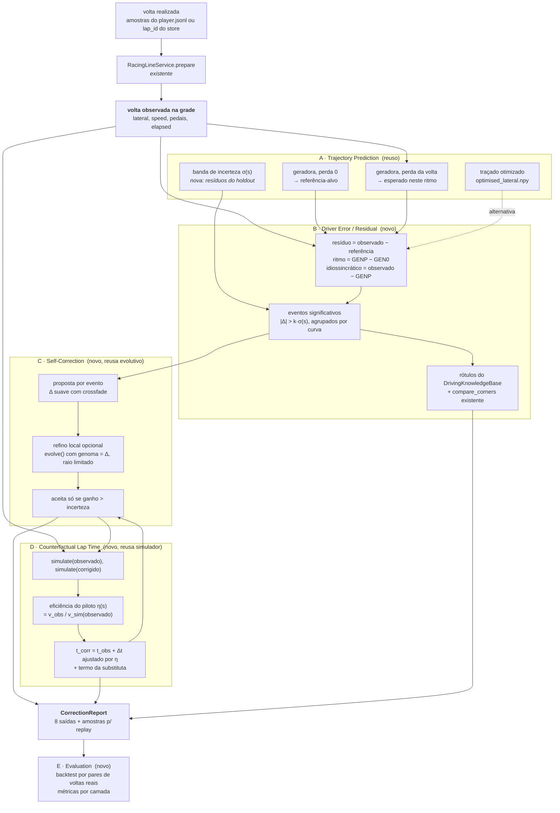

# Correção de trajetória em Interlagos — auditoria e arquitetura proposta

Documento de planejamento. **Nenhum código foi alterado.** Tudo o que está
descrito como "existe" foi conferido no código e, quando possível, executado
contra os dados reais em 2026-09-30. Onde um número vem de documentação do
projeto e não foi remedido, isso está dito.

Objetivo do módulo novo: receber **uma volta realizada** e produzir, offline,
trajetória observada, trajetória de referência, erros, correções recomendadas,
trajetória corrigida, tempo original, tempo estimado após correção e ganho
estimado. Controle em tempo real está fora do escopo.

---

## Parte 1 — Auditoria

### 1. Onde estão os dados de telemetria

| o quê | onde | formato |
|---|---|---|
| gravações brutas | `data/recordings/<sessão>/player.jsonl` | JSON por linha, um envelope por amostra |
| metadados da sessão | `data/recordings/<sessão>/metadata.json` | `playerRecordHz`, `trackCache`, `buildMethod` |
| índice por volta | `data/recordings/<sessão>/session-index.json` | offsets de byte por número de volta do jogo |
| oponentes | `data/recordings/<sessão>/opponents.jsonl` | stream separado, 20 Hz (não interessa aqui) |
| voltas válidas na grade | `data/ml/laps_grid.parquet` + `laps_grid_meta.json` | 113 voltas × 2167 pontos, 18 canais |
| inventário de todas as voltas | `data/ml/lap_inventory.parquet` | 1009 voltas, motivo de rejeição de cada uma |
| modelos treinados | `data/ml/models/{reference,surrogate}/` | `model.json` + `weights.pt` |
| traçado otimizado | `data/ml/optimization/optimised_lateral.npy` | vetor `lateral` na grade |
| envelope do carro | `data/ml/vehicle_envelope.json` | limites lateral/frenagem/tração por velocidade |
| alvo exportado p/ o coach | `data/reference_models/vhe_interlagos.optimal.json` | 60 tempos por fatia de `p` |

89 diretórios em `data/recordings` (11 GB), dos quais ~53 são Interlagos com
`player.jsonl` não vazio. `phase14_1_assisted_validation` é fixture sintética.

Leitura: `ml/data/recordings.py` (streaming, volta a volta) e
`ml/data/samples.py::flatten` (achata o envelope em colunas planas).

### 2. Campos disponíveis por amostra

Conferido despejando todos os caminhos de uma amostra real
(`2026-08-16_03-30-14`). Envelope: `type`, `timestamp` (ms desde a época),
`track`, `sessionTime`, `sample{...}`. Dentro de `sample`:

- **posição**: `worldPosition[3]`, `world_x/y/z`, `mapPosition{x,y}`, `x/y/z`
- **projeção do runtime**: `projectedWorldPosition`, `projectedPosition`,
  `distanceAlongTrack` (= `s`), `lateralOffset` (= `lateral_offset` = `L` =
  `alignment_drift`), `spline_t` (= `p`), `trackHeading[2]`, `dx/dy/dz`,
  `projectionDebug{nearestSegmentIndex, segmentT, distanceToTrack, tangentVector, normalVector}`
- **cinemática**: `heading` (rad), `speedKmh`, `speed` (m/s), `accel_g{x,y,z}`
- **volta**: `lap`, `lap_number`, `lap_time`, `sector`, `sessionTime`, `delta`
- **física agrupada** `carPhysics`: `motion{speedKmh, velocity{x,y,z}, accG{lateral,longitudinal,vertical}}`,
  `controls{throttle, brake, clutch, steerAngle, gear, rpm}`,
  `tyres{tyreCoreTemperature[4], tyrePressure[4], tyreWear[4], wheelSlip[4], wheelLoad[4], estimatedGripIndex[4], tyreDirtyLevel[4]}`,
  `suspension{suspensionTravel[4], rideHeight[2], camberRad[4]}`,
  `carState{fuel, maxFuel, abs, tc, drs, ...}`, `environment{surfaceGrip, roadTemp, offTrack, tyresOut, ...}`,
  `availability{hasRealThrottle, ...}`, `inferred{...}`

**Há três gerações de formato no disco, e isso tem consequência:**

| sessões | pedais no topo (`sample.throttle`) | `carPhysics.controls` |
|---|---|---|
| maio a meados de junho (ex.: `2026-06-14_12-23-46`) | **sim, reais** (18 047 de 20 001 amostras com acelerador ≠ 0) | ausente |
| fim de maio em diante, exceto as de 09/08 | sim | sim |
| `2026-08-09_*` (3 sessões, 56 das 113 voltas válidas) | **ausente** | sim, reais |

Os dois leitores do projeto têm pontos cegos opostos:

- `ml/data/samples.py::flatten` lê pedais **só** de `carPhysics.controls`. As
  sessões antigas saem sem pedal e caem no gate "canais ausentes" (161 voltas
  no inventário). O comentário em `ml/config.py` diz que a sessão
  `2026-06-14_12-23-46` "não tem os pedais" — **ela tem, no topo da amostra.**
- `core/assisted_analysis/utils.py::normalize_lap_dataframe` lê **só** o topo.
  Nas sessões de 09/08 ele devolve acelerador e freio zerados, sem erro.

### 3. Como a posição do carro é representada

Plano world **X/Z** do Assetto Corsa; Y é altura. `world_x`, `world_z` são a
fonte boa. `mapPosition = {x: world_x, y: -world_z}` é a convenção da
interface (o mesmo que `sample.y`; `sample.z` também vale `-world_z` e **não**
é a coordenada do mundo). Orientação: `heading` em radianos; velocidade
vetorial em `carPhysics.motion.velocity`.

### 4. Como a posição é projetada na pista

Duas projeções coexistem:

- **runtime** (`core/spatial_engine.py`, `core/projection/`): grava `s`, `L`,
  `p` e o `projectionDebug` em cada amostra.
- **ML** (`ml/track/geometry.py::TrackGeometry.project_sequence`): recalcula
  tudo. KD-tree sobre a centerline, 12 vizinhos, projeção nos dois segmentos
  de cada vizinho, e desempate por continuidade (o carro não avança mais de
  60 m entre amostras) — necessário onde a reta dos boxes corre ao lado do
  retorno. O `s` gravado é ignorado porque 6 sessões o gravaram `null` e as
  outras usaram versões diferentes da geometria.

**Convenção de sinal:** no ML, `lateral > 0` é **à esquerda** da centerline
(a normal do cache aponta para a esquerda). É o **oposto** do `lateralOffset`
gravado pelo runtime. Ida e volta: `TrackGeometry.to_world(s, L)` interpola
entre pontos da grade (não arredonda).

### 5. Como a distância ao longo de Interlagos é calculada

- Cache: centerline com 2680 vértices irregulares (1,4 a 5,0 m), campo
  `distance`, `trackLength = 4334,08 m`.
- ML (`load_geometry`): conserta degraus da centerline, passa-baixo de 60 m,
  **reparametriza por comprimento de arco** e reamostra numa grade uniforme de
  **2167 pontos × 2,000 m** (executado: confere).
- Volta: `alignment.unwrap_distance` remove o salto na linha de chegada;
  `resampling.resample_lap` interpola tudo na grade e rerreferencia o relógio
  para `s = 0`.
- Distância **percorrida pela trajetória** (não pela centerline):
  `trajectory.step_lengths` usa a forma fechada `|dr/ds| = √((1 − L·k)² + (dL/ds)²)`.
- O `p` do runtime é índice de vértice ÷ total, **não** distância: diverge até
  25 m de `s`. `ml/export/coaching.py::progress_to_distance` faz a conversão
  correta usando o vetor `p` do próprio cache.

### 6. Centerline, limites da pista e curvatura

Cache `data/cache/tracks/vhe_interlagos_gp_kn5_surface_interval_geometry.json`
(gerado do KN5 por raycast): `centerline[]` (x, z, worldY, distance, spline_t,
curvature, tangent), `normals[]`, `boundsLeft[]`, `boundsRight[]`,
`localWidth[]`, `p[]`; largura 5,61 a 21,1 m.

`TrackGeometry` (`ml/track/geometry.py`) expõe por ponto da grade: `x, z`,
`elevation`, `tangent`, `normal`, `curvature` (1/m, + = esquerda, Savitzky-Golay
de 12 m), `width_left`, `width_right`. Corredor permitido:
`corridor()` = largura − (meia-bitola 1,0 m − folga de zebra 0,5 m).

Derivados: `ml/track/corners.py::detect_corners` → **14 curvas** (executado),
com início, ápice, fim, sentido e raio mínimo; `ml/track/microsectors.py` → 60
microsetores de ~72 m. O simulador usa curvatura com janela de **30 m**, não
12 m, por motivo físico documentado em `ml/config.py`.

A geometria desenhada no mapa (`asphaltSurface`, `markingGeometry`) é outra
coisa e não entra em medida nenhuma.

### 7. Como as voltas são identificadas

| caminho | corte | identidade |
|---|---|---|
| ML (`ml/data/recordings.py`) | queda > 10 s no cronômetro `lap_time` | `"<sessão>#<ordem no arquivo>"`, ex. `…#0016` |
| runtime / replay (`core/recording/session_repository.py`) | contador do jogo, descartando os quadros de atraso do contador | `"rec__<sessão>__<número do jogo>"` |

O número do jogo **não é único** (trava no box: a sessão `2026-08-16_03-30-14`
tem quatro trechos gravados como volta 6). Não existe hoje um mapeamento entre
as duas identidades.

### 8. Sincronização temporal

Não há canais a sincronizar entre si: cada amostra é uma leitura única da
memória compartilhada, com todos os canais no mesmo instante. O alinhamento que
importa é **entre voltas**, e ele é **espacial**: `align_lap` projeta,
`resample_lap` leva para a grade de distância (ângulo desenrolado, marcha sem
interpolar, fechamento do laço extrapolando a última velocidade), e
`elapsed_s` é zerado em `s = 0`. Depois disso a linha `i` é o mesmo ponto da
pista em qualquer volta.

### 9. Frequência de amostragem real

`metadata.json` declara `playerRecordHz: 60`. Medido (mediana do Δt):

| sessão | Hz |
|---|---|
| `2026-08-16_03-30-14` | 60,4 |
| `2026-08-09_19-20-59` | 64,0 |
| `2026-06-14_12-23-46` | 32,1 |
| `2026-06-08_10-35-09` | 16,1 |

Nas 113 voltas válidas: mediana **58,4 Hz**, p10 52,8, mínimo 26,6. O gate
exige ≥ 20 Hz e < 3 buracos acima de 0,5 s (`ml/config.py`). A amostragem
baixa é a maior causa de rejeição (703 de 1009 voltas).

### 10. Canais de pilotagem

| canal | caminho (formato novo / antigo) | unidade | no store da grade? |
|---|---|---|---|
| acelerador | `carPhysics.controls.throttle` / `sample.throttle` | 0–1 | sim |
| freio | `carPhysics.controls.brake` / `sample.brake` | 0–1 | sim |
| volante | `carPhysics.controls.steerAngle` / `sample.steering` | não documentada; a limpeza aceita ±1,5 | sim |
| velocidade | `speedKmh` / `carPhysics.motion.speedKmh` | km/h | sim |
| marcha | `carPhysics.controls.gear` (float) / `sample.gear` (int) | — | sim (sem interpolar) |
| RPM | `carPhysics.controls.rpm` / `sample.rpm` | rpm | sim |
| g lateral | `carPhysics.motion.accG.lateral` / `accel_g.x` | g | sim |
| g longitudinal | `…accG.longitudinal` / `accel_g.z` | g | sim |
| g vertical | `…accG.vertical` / `accel_g.y` | g | **não** |
| escorregamento | média de `tyres.wheelSlip[4]` | — | sim |

Também no store: `lateral`, `elapsed_s`, `lap_time_s`, `x`, `z`, `off_track`,
`fuel`, `tyre_wear`, `grip_index`. Fora do store: `heading`, `clutch`,
`vertical_g`, cargas por roda, suspensão.

### 11. Replay como validação de uma trajetória corrigida

O replay **não simula nada**: reproduz amostras gravadas no navegador.

- Backend: `GET /api/laps/{lap_id}/replay` (`routers/recording.py`) devolve as
  amostras normalizadas por `main._normalize_replay_sample`.
- Frontend: `useTelemetryStore.startOfflineReplay({samples, referenceSamples, …})`.
  `TrackRenderer.drawReplayLapOverlay` desenha `samples` em amarelo e
  **`referenceSamples` como traço roxo tracejado**, usando `mapPosition`.
- Durante o replay, o overlay da racing line ao vivo é desligado.

Uso possível: gerar a trajetória corrigida como lista de amostras sintéticas
(`mapPosition = {x: world_x, y: −world_z}`, `lapTime`, `speedKmh`) e entregá-la
como `referenceSamples`. Isso valida **visualmente** (a linha cai no asfalto,
onde ela diverge, em que instante). A validação **física** de tempo é o
simulador de `ml/optimization/lap_time_model.py`. Validação no jogo (dirigir a
linha) não tem suporte no projeto.

### 12. Módulos de ML existentes

Subsistema `backend/ml/` (~9 200 linhas, offline, não importado pelo runtime):

| módulo | responsabilidade |
|---|---|
| `config.py` | constantes medidas: grade, gates, corredor, splits |
| `data/` | leitura das gravações, inventário, store na grade |
| `preprocessing/` | limpeza, projeção, reamostragem, gates, splits por sessão |
| `track/` | geometria, trajetória como `lateral(s)`, microsetores, curvas |
| `features/` | atributos de pista/pilotagem/desempenho, referência do piloto, escalas |
| `models/` | `TrackSequenceLSTM`, janelas, treino, linha de referência |
| `optimization/` | envelope, simulador, codificação em splines, aptidão, evolutivo |
| `comparison/` | volta × referência por microsetor e por curva |
| `validation/` | holdout, gêmeo não treinado, busca aleatória × evolutiva |
| `export/coaching.py` | exporta o traçado como JSON para o coach |
| `service.py` | `RacingLineService.prepare/analyse` sobre amostras cruas |
| `visualization/`, `scripts/` | gráficos e CLIs do pipeline |

Fora de `ml/`, sem aprendizado de máquina mas relevantes:
`core/assisted_analysis/` (classificação por regras: `EARLY_BRAKING`,
`LATE_APEX`, `TRAJECTORY_DEVIATION`… via `DrivingKnowledgeBase`),
`reference_model.py` (melhores microsetores do piloto) e `optimal_line.py`
(lê o JSON exportado).

Testes: `tests/test_ml_pipeline.py`, `test_ml_models.py`, `test_ml_service.py`,
`test_ml_export.py`, sobre uma pista circular sintética.

Ambiente: PyTorch 2.8 (CPU) está em `.venv/` na raiz. Em `backend/venv/` existe
só um resto quebrado do pacote `torch`.

### 13. O que reaproveitar do modelo LSTM

- **`TrackSequenceLSTM` + `LSTMConfig`**: a classe é genérica (entradas e saídas
  por configuração). Nenhuma arquitetura nova é necessária na primeira fase.
- **Geradora (`REFERENCE_TASK`)** já é o modelo de previsão de trajetória
  condicionado. Entradas: 7 atributos de pista + `sector_loss_s`,
  `lap_loss_s` + `fuel`, `tyre_wear`, `grip_index`. Saídas: `lateral`,
  `speed_kmh`, `brake`, `throttle`. Consultada com perda 0 → referência-alvo;
  consultada com a **perda da própria volta** → "o que é típico neste ritmo".
  Essa segunda consulta ainda não é usada em lugar nenhum e é o que permite
  separar erro de ritmo de erro idiossincrático.
- **Substituta (`SURROGATE_TASK`)**: forma da linha → tempo por passo. É um
  estimador de tempo que conhece este piloto; serve ao contrafactual.
- `sequences.py` (janelas circulares, `with_warmup`), `training.py`,
  `features/scaling.py`, `validation/` (holdout, gêmeo não treinado).

Limites medidos (de `docs/auditoria_ml.md`, não remedidos): MAE lateral no
teste **1,54 m**; 0,53 m em voltas < 88 s e **2,90 m** em voltas ≥ 88 s; erro
máximo 31 m. O volante (`steering`) não é alvo da rede.

### 14. O que reaproveitar da otimização evolutiva

- `lap_time_model.simulate/simulate_batch`: tempo e perfil de velocidade de
  **qualquer** vetor `lateral`. Viés −0,22 s, MAE 1,36 s, correlação 0,93
  contra as 113 voltas (documentado).
- `vehicle_model.VehicleEnvelope` (já ajustado em `vehicle_envelope.json`).
- `representation.TrajectoryEncoding`: base linear de splines a cada 25 m
  (`basis`, `lower`, `upper`). **Custa ~2 s** de representação sobre uma volta
  real — por isso a correção deve ser um *delta* sobre a volta observada, não a
  volta re-codificada.
- `fitness.FitnessEvaluator` (física + substituta + penalizações calibradas no
  p95 real), `fitness.ShapeReference` (`data/ml/shape_reference.json`).
- `evolution.evolve(evaluator, encoding, population, config)`: aceita qualquer
  população inicial e qualquer codificação → serve para busca **local**.
- `operators.py` (mutação suavizada, cruzamento por trecho),
  `seed.composite_best_segments` (costura com crossfade de 40 m — a mesma
  técnica para aplicar uma correção num trecho sem criar degrau).
- `comparison/reference_frame.reference_lap_frame` (trajetória → volta com
  velocidade, pedais e tempo) e `rescale_to_measured`.

Resultado relevante já medido: o traçado otimizado fica **0,77 s atrás** da
melhor volta real dentro do mesmo simulador, dentro do erro dele. Ou seja, o
modelo atual quase não enxerga ganho **de linha** na melhor volta; o ganho
está em voltas piores e na execução.

### 15. O que precisa ser criado

1. Decomposição do resíduo da volta (ritmo × idiossincrático) com banda de
   incerteza do modelo de referência.
2. Geração de correções **locais** (por evento/curva), não uma volta inteira.
3. Estimador contrafactual que reaproveite o simulador por **diferença** e
   ajuste à eficiência do piloto.
4. Backtest do contrafactual com pares de voltas reais.
5. Relatório único com as oito saídas pedidas e exportação para o replay.
6. Pré-requisitos de dados (Parte 2, seção 0).

---

## Parte 2 — Arquitetura proposta

### 0. Pré-requisitos (correções em código existente, antes do módulo novo)

| # | mudança | por quê |
|---|---|---|
| P1 | `ml/data/samples.py::flatten`: cair para `sample.throttle/brake/steering/gear/rpm` quando `carPhysics.controls` não existir | recupera sessões de maio/junho; hoje descartadas por um defeito do leitor, não dos dados |
| P2 | gravar `sourceHash` da geometria em `laps_grid_meta.json` e recusar store de outra geometria | o cache foi regravado em 25/08, o store é de 23/08 |
| P3 | reconstruir inventário + store + modelos depois de P1/P2 | o conjunto e os splits mudam |
| P4 | função de mapeamento `rec__<sessão>__<n>` ↔ `<sessão>#<ordem>` | o replay e o ML falam de voltas com identidades diferentes |

Não é para corrigir `normalize_lap_dataframe` dentro deste trabalho — é o
caminho do app, e o módulo novo não passa por ele. Fica registrado como
pendência separada.

### 1. Arquitetura

O módulo novo é **uma camada de orquestração** sobre o que existe. Nenhum
leitor, projeção, rede, simulador ou otimizador novo na primeira fase.



**A — Trajectory Prediction (reuso, sem modelo novo).** Três referências
disponíveis, escolhidas por parâmetro: geradora com perda 0 (padrão), geradora
com a perda da própria volta, e o traçado otimizado. A única peça nova é
`σ(s)`: o desvio do erro lateral/velocidade da geradora por ponto da grade,
medido nas voltas de validação. Sem ela não há como distinguir um desvio do
piloto de um erro do modelo — e os dois têm a mesma ordem de grandeza (1–3 m).

**B — Driver Error / Residual.** Fase 1 é estatística, não um classificador
novo: resíduo ponto a ponto, decomposição em ritmo × idiossincrático,
significância por `k·σ(s)`, agrupamento em eventos por curva (reusa
`detect_corners` e `compare_corners`), rótulos do `DrivingKnowledgeBase`
existente. Fase 2 (opcional, só se a fase 1 validar): regressão do
`sector_loss_s` real sobre os atributos do resíduo, para atribuir quanto da
perda de cada microsetor vem de linha, de velocidade mínima e de ponto de
frenagem. Alvo e dados já existem (`features/performance.py`).

**C — Self-Correction.** A trajetória corrigida é
`lateral_corr = lateral_obs + Σ_eventos w_e(s)·Δ_e(s)`, com `Δ_e` puxando em
direção à referência dentro da janela do evento e `w_e` em crossfade (mesma
técnica de `composite_best_segments`), clipada no corredor. Refino opcional:
`evolve()` com uma `TrajectoryEncoding` cujo genoma representa só `Δ` numa
janela, limites = raio de confiança. Isso evita o custo de ~2 s da
re-codificação da volta inteira. Cada evento é aceito só se D estimar ganho
maior que a incerteza.

**D — Counterfactual Lap-Time.** Nunca usar o tempo absoluto do simulador
(MAE 1,36 s). Usar diferença na mesma física:
`Δt_física = T_sim(corrigido) − T_sim(observado)`, por microsetor. Como o
piloto não anda no limite em todo lugar, ajustar pela eficiência medida
`η(s) = v_obs(s) / v_sim_obs(s)` (suavizada por microsetor) aplicada ao perfil
simulado da linha corrigida. A substituta entra como segundo estimador, e a
divergência entre os dois é reportada como incerteza. Atribuição por evento:
simulação "só este evento aplicado", não soma de parcelas.

Ganho de **execução** (frear mais tarde, velocidade mínima maior na mesma
linha) não é ganho de linha. O simulador já assume execução ótima, então
somar os dois conta duas vezes. O relatório separa: `ganho_linha` (de D) e
`ganho_execução_referência` (do `DriverReference`: microsetor atual − melhor
do piloto), sem somá-los numa só manchete.

**E — Evaluation.** Ver seção 7.

### 2. Estrutura de arquivos

```
backend/ml/
  data/samples.py                 # P1 (alteração)
  data/lap_store.py               # P2 (alteração: hash da geometria)
  correction/                     # novo pacote
    __init__.py
    reference.py                  # A: escolhe a referência, carrega σ(s)
    uncertainty.py                # A: ajusta σ(s) nos resíduos de validação
    residuals.py                  # B: resíduo, decomposição, eventos
    proposals.py                  # C: Δ por evento, crossfade, refino local
    counterfactual.py             # D: Δt física, η(s), substituta, atribuição
    report.py                     # CorrectionReport + to_replay_samples()
    pipeline.py                   # correct_lap(samples | lap_id) -> report
  scripts/
    fit_uncertainty.py            # gera data/ml/correction/uncertainty.npz
    correct_lap.py                # CLI de uma volta
    evaluate_correction.py        # E: backtest e métricas
  validation/
    counterfactual.py             # E: backtest por pares de voltas
backend/tests/
  test_ml_correction.py           # pista circular sintética, como os demais
data/ml/correction/               # artefatos (fora do versionamento)
docs/correcao_trajetoria_auditoria.md   # este documento
```

Integração com o app (endpoint e replay) fica para depois da validação. Se
acontecer, segue o padrão já adotado: o `ml` exporta JSON e o backend
empacotado só lê.

### 3. Fluxo dos dados

1. **Entrada**: lista de amostras no formato do `player.jsonl`, ou um `lap_id`
   do store.
2. `RacingLineService.prepare` → limpeza, projeção, gates, grade de 2167 pontos.
   Volta rejeitada nos gates não é analisada (o relatório diz o motivo).
3. `features.lap_features` com a `DriverReference` → `sector_loss_s`, `lap_loss_s`.
4. A: geradora em perda 0 e na perda da volta; `σ(s)` do artefato.
5. B: resíduos, eventos significativos, rótulos.
6. C: propostas por evento → trajetória corrigida candidata.
7. D: Δt por evento e total; aceita/rejeita eventos; trajetória final.
8. `CorrectionReport`: observada, referência, erros, correções, corrigida,
   tempo original, tempo estimado, ganho (com intervalo); opcionalmente
   amostras sintéticas para `referenceSamples` do replay.

### 4. Features de entrada

| camada | entradas (todas já existentes no código) |
|---|---|
| A | `TRACK_FEATURES` (`curvature`, `curvature_abs`, `curvature_rate`, `track_width`, `elevation_slope`, `corner_flag`, `distance_to_apex`) + `sector_loss_s`, `lap_loss_s` + `fuel`, `tyre_wear`, `grip_index` |
| B | canais da volta na grade (`lateral`, `speed_kmh`, `brake`, `throttle`, `steering`, `lateral_g`, `longitudinal_g`) + saídas de A + `σ(s)` + curvas e microsetores |
| C | `lateral_obs`, `lateral_ref`, eventos de B, corredor, `ShapeReference` |
| D | `lateral_obs`, `lateral_corr`, `speed_kmh` observada, `VehicleEnvelope`; para a substituta, `TRACK_FEATURES` + `SHAPE_FEATURES` + contexto |

### 5. Targets

| camada | alvo |
|---|---|
| A | sem treino novo. `σ(s)`: |erro| da geradora por ponto, nas voltas de validação |
| B fase 1 | sem alvo supervisionado (teste estatístico) |
| B fase 2 | `sector_loss_s` real de cada microsetor |
| C | sem alvo; é otimização sob restrição |
| D | tempo da volta. Na validação, o tempo **medido** de outra volta real (seção 7) |

### 6. Métricas

| camada | métrica | aceitação proposta |
|---|---|---|
| A | MAE/RMSE lateral e velocidade por faixa de ritmo; cobertura de `±k·σ(s)` em voltas rápidas de teste | cobertura ≈ nominal (ex.: 90 % para k = 1,64) |
| B | taxa de falso positivo: fração de pontos marcados nas voltas mais rápidas de teste; concordância com `compare_corners` | FP ≤ ~10 % |
| B fase 2 | R² e MAE (s) da perda por microsetor, fora da amostra | melhor que prever a média |
| C | violação de corredor (= 0), `weaving` e `curvature_jerk` ≤ p95 real, deslocamento máximo, nº de eventos | todas as restrições satisfeitas |
| D | MAE, viés e correlação de Spearman no backtest por pares; MAE por microsetor | MAE do Δt bem abaixo de 1,36 s (o absoluto) |
| fim a fim | ganho estimado ≤ volta − volta ideal do piloto; estabilidade entre sementes; fração de voltas com ganho dentro da incerteza | ganho reportado só quando acima do intervalo |

### 7. Estratégia de treinamento e validação

- **Splits**: o conjunto é dominado por duas sessões (`2026-08-09_19-20-59`: 52
  voltas; `2026-06-20_13-13-02`: 39). O split atual 60/39/14 põe uma sessão
  inteira na validação. Proposta: **leave-one-session-out** sobre as sessões
  com voltas válidas, reportando por sessão e por faixa de ritmo (< 88 s e ≥ 88 s).
- **`σ(s)`**: ajustado só com a parte de validação de cada dobra; nunca com a
  volta sendo analisada.
- **Backtest do contrafactual (o teste central)**: não existe a volta
  "corrigida" real, mas existem pares de voltas reais do mesmo piloto. Para
  cada par (A, B) da mesma sessão, prever `t_B = t_A + Δt(A → B)` usando
  **só** as trajetórias e a velocidade de A, e comparar com o `t_B` medido.
  Versão por microsetor, restrita a pares com velocidade de entrada parecida
  (|Δv| < 3 km/h), para isolar o efeito de linha. Linhas de base: Δt = 0 e
  tempo absoluto do simulador.
- **Fase 2 de B** só é treinada se o backtest de D passar; caso contrário o
  número que ela atribuiria a "linha" não é confiável.
- Reprodutibilidade: sementes fixas (já padrão no projeto), hash da geometria
  e do store gravados em cada artefato.

### 8. Riscos e limitações

1. **Um piloto, ~10 sessões efetivas, duas dominantes.** Generalização entre
   pilotos não é avaliável.
2. **Erro do modelo de referência da mesma ordem das correções.** 1,5 m de MAE
   lateral no teste e 2,9 m em voltas lentas. Sem `σ(s)` o sistema
   "corrigiria" ruído do próprio modelo.
3. **Simulador quase-estacionário**: sem transferência de carga, mapa de motor
   ou pneu. Ganhos de poucos décimos podem estar abaixo da resolução do Δt —
   até o backtest medir, não há como saber.
4. **O modelo atual quase não vê ganho de linha na melhor volta** (traçado
   otimizado 0,77 s atrás dela). Para voltas rápidas, o resultado esperado e
   honesto pode ser "nenhuma correção de linha significativa".
5. **Dupla contagem linha × execução**, se as duas parcelas forem somadas.
6. **Contrafactual não é causal de verdade**: mudar a linha numa curva muda a
   velocidade de entrada na seguinte. Por isso a atribuição simula a volta
   inteira com cada evento, e não soma parcelas independentes.
7. **Inconsistência de formato entre gerações de gravação** (P1) e
   **geometria mais nova que o store** (P2).
8. **Sinal lateral oposto** entre `lateralOffset` gravado e `lateral` do ML.
9. **Identidade de volta diferente** entre replay e ML (P4).
10. **Replay não é validação física**; não há validação dentro do jogo.
11. **Volante não é modelado**: as correções saem como posição lateral, ponto
    de frenagem e velocidade mínima, não como ângulo de direção.
12. **Corredor ≠ regra de limite de pista**: o corredor usa largura medida +
    0,5 m de zebra; a regra real de limites não está codificada.
13. **Ambiente**: PyTorch só no `.venv` da raiz; o backend empacotado não pode
    importar `ml`.

---

## Próximo passo sugerido

Fazer P1–P4 e, antes de C, o **backtest do contrafactual (D) com o simulador
existente**. É barato (nenhum modelo novo) e decide se o resto vale a pena: se
o Δt entre voltas reais não for previsível bem abaixo de 1,36 s, o "ganho
estimado" do módulo não teria significado, e a arquitetura precisa de outro
estimador antes de seguir.
