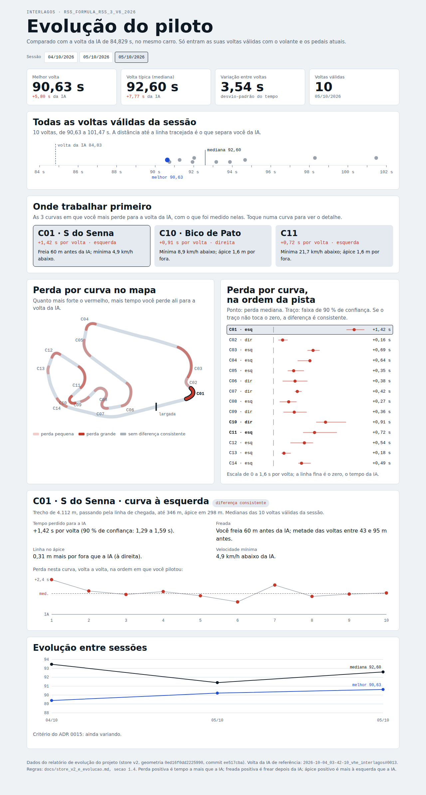
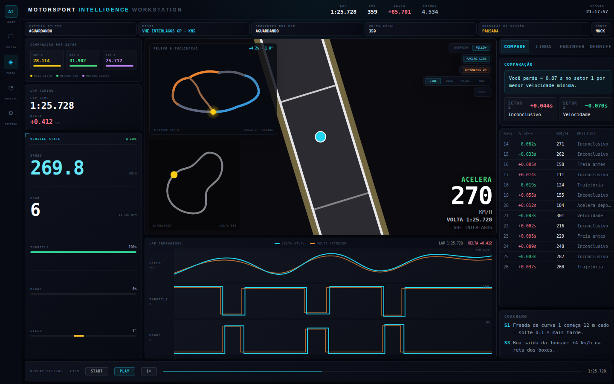

# Inventário das visões do software de coleta

- **Data:** 10/10/2026. **Autor:** Claude (Cowork), a pedido do Eduardo.
- **Fonte:** leitura do código em `develop` (`frontend/src`, última mudança em 04/10, no `CoachingFeed`) e do painel de evolução gerado em 08/10. O app não foi executado. As telas do app dependem do backend e das gravações, por isso as únicas imagens aqui são das duas visões que abrem sozinhas: o painel de evolução e a maquete da tela Pista.
- **Complementa:** `docs/dashboard_inventario.md` (problemas e estrutura nova). Aqui cada visão tem uma linha.

**Como ler as colunas:**

- **Quando:**
  - ao vivo: durante a volta;
  - replay: volta gravada tocando na tela;
  - pós-sessão: análise de voltas gravadas.
- **Estado:**
  - funciona;
  - dado fixo: mostra um valor escrito no código;
  - medida estimada: calcula de um jeito diferente do relógio do jogo, ou contra o ADR 0012;
  - depuração: informação de desenvolvimento na tela do piloto;
  - não usado: o componente existe, mas nenhuma tela o mostra.
- **Destino**, nas 5 telas do protótipo:
  - **como está:** vai para a tela nova sem mudar;
  - **com ajuste:** vai para a tela nova com uma mudança pequena, descrita na linha;
  - **substituída:** sai, e uma visão nova cobre o que ela fazia;
  - **sai:** deixa de existir na dashboard;
  - **decidir:** precisa da decisão do Eduardo.

## 1. Tela Início (`HomePage.tsx`)

| # | Visão (nome na tela) | O que mostra | Dados | Quando | Estado | Destino |
|---|---|---|---|---|---|---|
| V01 | "Estado da coleta" | 4 passos da coleta: jogo aberto, sessão carregada, gravação, voltas | `/api/runtime/status` e `/api/recording/status`, a cada 5 s | ao vivo | funciona | **com ajuste** → Antes de pilotar, com a taxa real e os canais físicos |
| V02 | "Sessoes gravadas" | contadores Sessões, Voltas e Melhor, e até 6 sessões | `/api/sessions` | pós-sessão | funciona; "Melhor" vem do resumo de sessões do app, e não do `lap_time_s` do store v2 | **com ajuste** → Sessões, com o tempo do store v2 |
| V03 | Atalhos ("Abrir analise", "Telemetria ao vivo", "Diagnostico do sistema") | botões de navegação | — | — | funciona | **sai**: o menu cobre |

## 2. Tela Pista (`Dashboard.tsx`)

### 2.1 Faixas e painéis laterais

| # | Visão | O que mostra | Dados | Quando | Estado | Destino |
|---|---|---|---|---|---|---|
| V04 | Cabeçalho "Motorsport Intelligence Workstation" | tempo, delta, volta, frames, indicadores LINK, STREAM, SPATIAL e AI_CORE, "BUILD v13.0" | store | ao vivo | dado fixo: SPATIAL e AI_CORE sempre acesos, versão fixa; repete números de outros painéis | **sai** |
| V05 | Faixa da sessão | "CAPTURA PLAYER", "PISTA", "OPONENTES UDP 8765", "VOLTA ATUAL", "GRAVAÇÃO 60 HZ", "FONTE" | `/api/runtime/status` e `/api/recording/status`, a cada 2,5 s | ao vivo | dado fixo: "60 HZ" escrito no código | **com ajuste** → Antes de pilotar, junto da V01 |
| V06 | "Comparacao por setor" | SET 1, 2 e 3 (terços da volta), com cores contra a referência | store, relógio do jogo | ao vivo e replay | medida estimada: os setores não são os do jogo, e a legenda "melhor seu" engana | **substituída** pelas 14 curvas |
| V07 | "Lap Timing" | tempo de volta e delta | store, relógio do jogo | ao vivo | funciona | **sai** da dashboard; durante a volta, o equivalente vai para dentro do jogo (ADR 0020, a decidir) |
| V08 | "Vehicle State" | velocidade, marcha e RPM, acelerador, freio, volante em graus | store | ao vivo | volante = `steering × 90`, um fator fixo sem unidade conferida | **sai** da dashboard, pelo mesmo motivo da V07 |

### 2.2 Mapa (`TrackRenderer` e camadas em `components/map/`)

| # | Visão | O que mostra | Dados | Quando | Estado | Destino |
|---|---|---|---|---|---|---|
| V09 | Mapa da pista | asfalto, pintura e zebras do próprio jogo; carro; câmera FOLLOW (padrão) ou OVERVIEW; zoom | `/api/track/geometry` (projeção do runtime); posição do carro no mundo | ao vivo e replay | funciona, mas **espelhado**: desenha o circuito no sentido horário, e Interlagos corre no anti-horário (o minimapa e o relevo estão certos; conferido em 10/10). Também usa a projeção antiga e refaz todo o desenho a cada quadro | **com ajuste** → Volta: corrigir o espelhamento; camada dos 60 microssetores; linha de referência = a referência escolhida; depuração para Sistema |
| V10 | Linha de corrida sobre o mapa | modos LINE, DIAG e PEDAL; modos de depuração RAW, PTS, SEGS, SMTH e SPEED; legenda REF REAL, FREIO, ACEL, PERDA e TRAJ | `/api/live/racing-line?microSectors=50`, a cada 6 s (melhor volta do buffer) | ao vivo | medida estimada: 50 microssetores por fração da spline; a rota trava o servidor 1 a 1,8 s a cada 6 s | **substituída** pela camada dos 60 microssetores; os modos de depuração vão para Sistema |
| V11 | Rastro (só em FOLLOW) | últimos 14 s, colorido pelo pedal | store | ao vivo | funciona | **com ajuste** → "Volta com fantasma": traçado desde o início da volta, colorido pelo pedal, também para o fantasma |
| V12 | "Relevo & inclinacao" (canto do mapa) | fita 3D da pista, inclinada, colorida pelo gradiente | geometria do runtime | ao vivo e replay | orientação certa; não tem os valores que a maquete prometia (inclinação e altitude); o marcador do carro pode sair da borda do quadro | **com ajuste** → canto superior direito da "Volta com fantasma", com a altitude e a inclinação no ponto do carro (decisão do Eduardo, 10/10) |
| V13 | Minimapa (canto) | pista inteira, carro, "VOLTA n" | geometria do runtime | ao vivo e replay | funciona, orientação certa; no modo FOLLOW é a única visão da volta inteira | **com ajuste** → canto inferior direito da "Volta com fantasma", com o carro, o fantasma e a curva atual |
| V14 | Leitura do canto | ACELERA/FREIO/INERCIA, velocidade, "VOLTA m:ss" | store | ao vivo e replay | lê o quadro ao vivo mesmo durante o replay | **sai**: a leitura do replay da tela Volta substitui |
| V15 | Oponentes | discos com rumo, lista "Opponents +/-", dica com Speed, Spline e World X/Y/Z | UDP (porta 8765) | ao vivo | depuração: coordenadas do mundo na tela | **sai** da tela do piloto |
| V16 | "LAP COMPARISON" | velocidade, acelerador e freio por % da volta, volta atual contra a anterior; botão "LAP DBG" | store | ao vivo e replay | funciona; eixo em %; "LAP DBG" é depuração | **com ajuste** → Volta: eixo em metros e referência escolhida (junta com a V25) |

### 2.3 Coluna direita e barra inferior

| # | Visão | O que mostra | Dados | Quando | Estado | Destino |
|---|---|---|---|---|---|---|
| V17 | Aba "Compare" | setores, PERDAS/GANHOS, tabela SEG, D REF, KMH, D OPP e MOTIVO, frase "Voce perde aproximadamente X s" | calculado no front | ao vivo | medida estimada: tempo por distância ÷ velocidade | **substituída** pela diferença acumulada e pelas 14 curvas |
| V18 | Aba "Linha" | STATUS, FONTE, MELHOR, HIST, VALIDOS; "TOP VOLTAS"; setores; PERDAS/GANHOS; tabela SEG, DELTA, KMH, DESV e ISSUE | `/api/live/racing-line`, a cada 5 s | ao vivo | medida estimada: tempo por timestamp e delta por distância ÷ velocidade | **substituída**, como a V17 |
| V19 | Aba "Engineer" ("AI Race Engineer") | falas do engenheiro; rodapé "Neural-linked coaching" | WebSocket, eventos `engineer_speech` | ao vivo | dado fixo no rodapé; repete o que a V21 já mostra | **sai** |
| V20 | Aba "Debrief" ("Session Debrief") | médias da sessão e três "AI RECOMMENDATIONS" | store | ao vivo | dado fixo: as três recomendações não dependem dos dados | **sai** |
| V21 | "AI Coaching" | frases do coach, com a referência ("VOLTA DA IA" ou "SUA MELHOR"), o valor e a barra de severidade | WebSocket, eventos `coaching_event` | ao vivo e replay | funciona; "SETOR N" é o microssetor N de 60; mostra JSON cru quando falta um campo | **com ajuste** → Volta: frases marcadas no replay e no mapa, com "microssetor" no lugar de "setor" |
| V22 | Barra inferior | ao vivo: Lap Time, Delta, Lap Delta (o mesmo valor do Delta), Lap, Ref Lap, Progress e Frames, mais fonte "F1-25 UDP" / "IRACING SDK" e Start/Stop; em replay: play, velocidade, posição | store; Start e Stop chamam rotas que não existem | ao vivo e replay | dado fixo e rotas inexistentes na parte ao vivo; replay funciona | **com ajuste** → Volta: só o replay |

## 3. Tela Análise (`AnalysisPage.tsx`)

| # | Visão | O que mostra | Dados | Quando | Estado | Destino |
|---|---|---|---|---|---|---|
| V23 | Aba "Voltas" ("Voltas capturadas") | "Sessão atual" e "Arquivo local", com botões REPLAY e ASSIST; textos "Phase 13" | `/api/sessions`, `/api/sessions/{id}/laps`, `/api/laps/{id}/replay` | pós-sessão | funciona; tempo pelo maior `lap_time` amostrado; o replay começa aqui, mas só toca na tela Pista | **com ajuste** → seletor de sessão e volta (Sessões e Volta), com o tempo do store v2; o replay abre direto a tela Volta |
| V24 | Aba "Analise assistida" ("Assisted Analysis") | Summary com `totalEstimatedGainS`, External Reference, Main Losses e Corner Diagnostics | `/api/analysis/assisted/lap/{id}` | pós-sessão | medida estimada: soma de ganhos estimados (contra o ADR 0012) | **substituída** pelas 14 curvas, com os números do relatório de evolução |
| V25 | Aba "Tracados" ("Lap Traces") | velocidade, acelerador e freio por % da volta: referência, volta analisada e volta ao vivo | `/api/analysis/assisted/lap/{id}/telemetry` | pós-sessão | funciona | **com ajuste** → Volta, junto com a V16 |
| V26 | Aba "Elevacao" ("Perfil de elevacao") | altitude por distância, com o gradiente e leitura ao passar o mouse | `/api/track/geometry` (eixo do runtime) | pós-sessão | funciona | **decidir** |

## 4. Tela Sistema (`DiagnosticsPage.tsx`)

| # | Visão | O que mostra | Dados | Estado | Destino |
|---|---|---|---|---|---|
| V27 | "Runtime" | cerca de 40 indicadores: backend, fonte, taxas, latências, contadores, pastas | IPC do Electron, `/api/runtime/status` e `/api/runtime/performance`, a cada 4 s | funciona | **como está** → Sistema |
| V28 | "Assetto Setup" | jogo detectado, plugin, caminhos e portas | IPC e `/api/runtime/status` | funciona; repete linhas da V27 | **como está** → Sistema |
| V29 | Versão | versão, commit, traçado do modelo, botão "Atualizar" | IPC do Electron | funciona | **como está** → Sistema |
| V30 | "Qualidade dos dados" | Player/Shared Memory, Oponentes/UDP, voltas válidas, parciais e inválidas, pista, comparação, diagnósticos | `/api/validation/data-quality` | funciona | **como está** → Sistema |
| V31 | "Car Physics" | Motion And Controls, Tyres, Car And Environment, Opponent Physics | `/api/live/player-physics`, a cada 1 s | funciona | **como está** → Sistema |
| V32 | PERF do mapa | FPS, P95, memória, contadores de render | medidas do próprio front | depuração | **como está** → Sistema (hoje fica na tela Pista) |

## 5. Prontas e sem uso

| # | Visão | O que mostra | Estado | Destino |
|---|---|---|---|---|
| V33 | G-G Diagram | círculo de tração: aceleração lateral × longitudinal, com rastro | não usado | **decidir**: combina com o "uso da aderência" do bloco de técnica |
| V34 | Stability | estabilidade pela taxa de guinada | não usado | **sai** |
| V35 | Cognitive | barras Conf, Aggr, Smth e Focs | não usado; nada alimenta esses números | **sai** |
| V36 | Session Timeline | linha do tempo da sessão com marcadores de evento | não usado; os setores que ela lê nunca são preenchidos | **sai**: a posição do replay cobre |

## 6. Fora do app

| # | Visão | O que mostra | Dados | Estado | Destino |
|---|---|---|---|---|---|
| V37 | Painel de evolução (`data/ml/evolucao/painel.html`, aberto no navegador) |  • sessões e números principais;  • todas as voltas válidas;  • "Onde trabalhar primeiro";  • perda por curva no mapa e na ordem da pista, com faixa de 90%;  • detalhe da curva, com a perda volta a volta;  • evolução entre sessões e critério do ADR 0015 | relatório de evolução, gerado pelo `atualizar_coach` | funciona; segue os ADRs 0012 e 0015 | **com ajuste** → Evolução, com o bloco de técnica |
| V38 | Maquete da tela Pista, fase 16 (`frontend/mockups/dashboard-3-visoes.html`) | desenho de referência da tela Pista, com dados fictícios ("FONTE MOCK") | nenhum | referência; implementada quase toda | fica como histórico |

**Dois pontos do painel de evolução (V37) para decidir:**

- **Nome das sessões:** as sessões `2026-10-05` e `2026-10-05-2` aparecem as duas como "05/10/2026" nos botões e no gráfico entre sessões. O protótipo usa "05/10" e "05/10 (2)".
- **Nomes populares de curva:** o painel junta nomes populares a dois códigos: "C01 · S do Senna" e "C10 · Bico de Pato" (`painel_evolucao.html:147`). Pela regra de nomes técnicos, o protótipo usa só C01 a C14 e o lado da curva.

### Imagens

## 7. Resumo

| Destino | Visões | Quantas |
|---|---|---|
| como está | V27 a V32 | 6 |
| com ajuste | V01, V02, V05, V09, V11, V12, V13, V16, V21, V22, V23, V25, V37 | 13 |
| substituída | V06, V10, V17, V18, V24 | 5 |
| sai | V03, V04, V07, V08, V14, V15, V19, V20, V34, V35, V36 | 11 |
| decidir | V26, V33 | 2 |
| referência | V38 | 1 |

## 8. Visão nova pedida em 10/10: "Volta com fantasma"

Inspirada num vídeo de comparação de voltas (conta @formulytics, comparação 2017 × 2026 em Sepang). Está no protótipo, na tela Volta.

- **Câmera próxima** que acompanha o carro (80, 150 ou 400 m na tela; pode girar com o carro). Reaproveita a V09.
- **Traçado que se forma** desde o início da volta, colorido pelo pedal:
  - vermelho: freio ≥ 0,15, o mesmo limiar do ponto de frenagem;
  - verde: acelerador ≥ 0,9;
  - amarelo: acelerador parcial ou sem pedal.

  Reaproveita a V11.
- **Fantasma da referência** (volta da IA ou sua melhor), posicionado pelo **tempo**: onde a referência estava depois do mesmo tempo. Tem dois modos:
  - **por curva** (padrão): o fantasma recomeça junto com o piloto no início de cada uma das 14 curvas. A diferença mostrada é só a daquela curva, e as 14 somam a diferença da volta;
  - **volta inteira**: com 5,8 s de diferença para a IA, o fantasma sai da câmera já na primeira parte da volta. Fora da tela, uma seta indica a distância.
- **Leitura dos dois carros:** estado do pedal, velocidade e tempo de cada um, e a diferença no centro.
- **Canto superior direito:** relevo (V12), com a altitude e a inclinação no ponto do carro.
- **Canto inferior direito:** pista inteira (V13), com os dois carros e a curva atual.
- **Dados:**
  - **posição** dos dois carros = linha central da geometria oficial + deslocamento lateral do store v2 (confere com o `x`, `z` gravado: 2 mm de mediana);
  - **pista desenhada** = as mesmas camadas tratadas que o mapa do software desenha (`drawTrackSurface` em `OverlayRenderer.tsx`), lidas do cache `vhe_interlagos_gp_kn5_surface_interval_geometry.json`:
    - `asphaltSurface.loops`: asfalto do jogo, já sem as faixas de pintura e de zebra, preenchido par-ímpar;
    - `markingGeometry.features`: pintura classificada (limite em branco, pit lane em amarelo, serviço em cinza), com as mesmas espessuras do app;
    - `kerbGeometry.polygons`: zebras em listras de 1,1 m;
  - **altitude** do relevo vem da geometria do ML (mesmo `geometry_id`); o perfil é contínuo (segunda diferença máxima de 3,4 cm a cada 2 m);
  - minimapa, relevo e mapa de microssetores usam a linha central oficial, que já é a consertada.
- **Correção de 10/10:** a primeira versão desenhava a borda da pista como linha central oficial ± largura do modelo. Esse corredor é a reconstrução usada para projetar a telemetria e para o otimizador; não é o desenho tratado. Ele tem degraus de até 0,8 m entre amostras vizinhas (por exemplo, em 280, 370 e 3890 m) e por isso aparecia uma ondulação na borda em reta. O próprio app deixou de desenhar esse corredor pelo mesmo motivo (comentário de `drawTrackSurface`). Comparação em `docs/imagens/visoes/pista_antes_depois.png`.
- **Conferência:** 99,2% dos pontos das voltas caem sobre asfalto, zebra ou pintura (31.436 pontos, todas as voltas do protótipo). Os 0,8% restantes (237 pontos) ficam até 2,4 m fora; 141 deles estão entre 1400 e 1750 m. Não verifiquei se são saídas de pista reais (o pedido 27 confere com o sinal de pneus fora do jogo).

As 5 visões substituídas são as que medem tempo de um jeito diferente do relógio do jogo, ou mostram ganho estimado. Todas as que funcionam e servem a uma das 5 telas são reaproveitadas.
